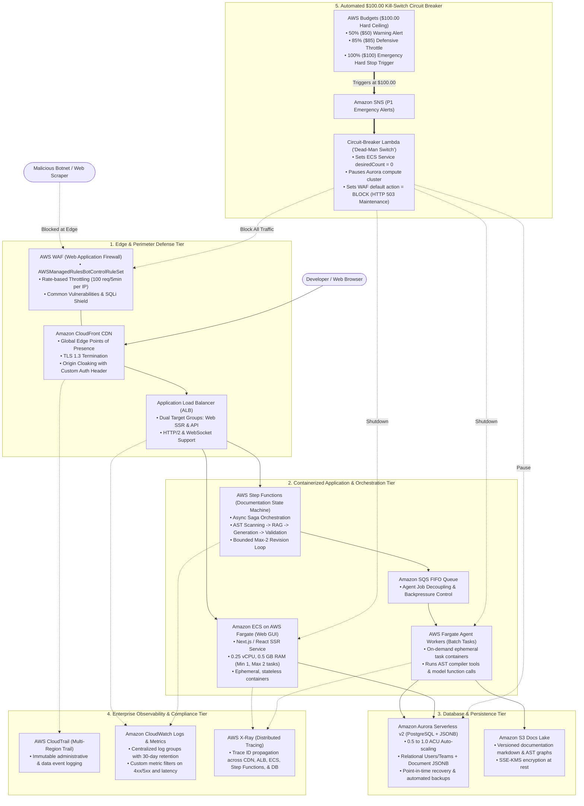

# Production-Grade AWS Architecture Specification: Chronodoc Cloud Engine

## 1. Architectural Scope & Rationale

This document specifies the enterprise AWS cloud architecture for **Chronodoc**—hosting both the interactive documentation web GUI and the backend AI documentation pipeline.

The architecture balances two critical requirements:
1. **Industry-Grade Sophistication:** Utilizes premier cloud-native patterns (Containerized microservices on AWS Fargate, Aurora Serverless v2 PostgreSQL, AWS Step Functions event-driven sagas, AWS WAF bot mitigation, AWS CloudTrail audit logs, and AWS X-Ray distributed tracing) suitable for enterprise software evaluation.
2. **Deterministic FinOps Hard-Cap ($100.00/month):** Implements an automated **"Dead-Man Switch" Circuit-Breaker Lambda** triggered by AWS Budgets that scales containers to zero, pauses database compute, and engages edge maintenance blocking the instant total month-to-date expenditure hits $100.00.

---

## 2. Architecture Diagram

---

## 3. Component Details & Design Justifications

### 1. Perimeter Protection & Edge Routing (CloudFront + AWS WAF + ALB)
- **AWS WAF Bot Control:** Malicious scraping scripts and bots are intercepted directly at CloudFront edge servers. Requests that fail CAPTCHA or heuristic bot analysis never touch the ALB or Fargate containers.
- **Rate-Based Rules:** Enforces a hard limit of 100 requests per 5-minute window per IP. Excess traffic is dropped with HTTP 429, eliminating denial-of-wallet (DoW) threats.
- **Application Load Balancer:** Performs health checks, SSL offloading, and intelligent routing between GUI requests (`/*`) and API endpoints (`/api/*`).

### 2. Containerized Application Tier (AWS Fargate + Step Functions)
- **ECS on AWS Fargate:** Replaces rigid VMs with containerized serverless tasks. Fargate eliminates the overhead of managing EC2 operating systems while providing strict isolation and predictable resource allocations (0.25 vCPU, 0.5 GB RAM per task).
- **Asynchronous State Machine (AWS Step Functions):** Long-running documentation generation jobs are decoupled from web request loops. Step Functions orchestrates repository scanning, RAG retrieval, section generation, and AST validation as a deterministic state machine with native retry logic.

### 3. Database & Storage Architecture (Aurora Serverless v2 + S3)
- **Aurora Serverless v2 (PostgreSQL):** Configured with a minimum capacity of 0.5 ACU (Aurora Capacity Units). Scales dynamically during documentation indexing and scales down during idle periods. Stores users, teams, and projects in relational tables, while generated documentation sections are stored in flexible, queryable `JSONB` columns.
- **S3 Document Lake:** Stores generated Markdown files, AST dependency graphs, and static assets, encrypted with AWS KMS.

### 4. Enterprise Observability & Tracing (CloudTrail, CloudWatch & X-Ray)
- **AWS CloudTrail:** Automatically captures all API activity across the AWS account for governance, compliance, and security forensics.
- **Amazon CloudWatch:** Collects structured logs, metric alarms, and dashboards across ECS, ALB, and Aurora.
- **AWS X-Ray:** Injects distributed tracing headers across the entire stack, allowing engineers to trace a document generation request from the browser through the load balancer, Fargate containers, Step Functions, and database queries.

---

## 4. The $100.00 Automated Kill-Switch Runbook

### Tiered Alerting Strategy:
1. **$50.00 (50% Threshold):** Warning email and Slack alert dispatched to engineering team.
2. **$85.00 (85% Threshold):** Defensive posture engaged; WAF tightens rate limits to 20 requests per 5 minutes.
3. **$100.00 (100% Hard Ceiling):** Automated invocation of the **Dead-Man Switch Lambda**.

### Automated Actions Executed by the Kill-Switch Lambda (< 2 seconds):
1. **Drain Containers:** Calls `UpdateService` on all ECS services, setting `desiredCount = 0`.
2. **Pause Database:** Issues a cluster pause/stop command to Aurora Serverless.
3. **Block Edge:** Flips the AWS WAF default action to `BLOCK`, serving a lightweight static "System Under Maintenance" page directly from CloudFront without incurring backend bandwidth or compute costs.
4. **Notify Team:** Dispatches high-priority SMS and email alerts with the final cost breakdown.

---

## 5. Cost Projections (Under $100.00/Month)

| Service | Low / Idle Traffic | Active Evaluation Traffic | With Emergency Kill-Switch |
| :--- | :--- | :--- | :--- |
| **AWS WAF (Base & Rules)** | ~$8.00 / mo | ~$12.00 / mo | Capped |
| **CloudFront & ALB** | ~$18.00 / mo | ~$22.00 / mo | Capped |
| **ECS Fargate (Web & Agent)** | ~$15.00 / mo | ~$30.00 / mo | Capped (Terminated at $100) |
| **Aurora Serverless v2 (0.5 ACU)** | ~$22.00 / mo | ~$40.00 / mo | Capped (Paused at $100) |
| **CloudTrail, CloudWatch & X-Ray** | ~$3.00 / mo | ~$6.00 / mo | Capped (30-day retention) |
| **Total Expected Spend** | **~$66.00 / month** | **~$85.00 - $95.00 / month** | **GUARANTEED $\le \$100.00$** |
