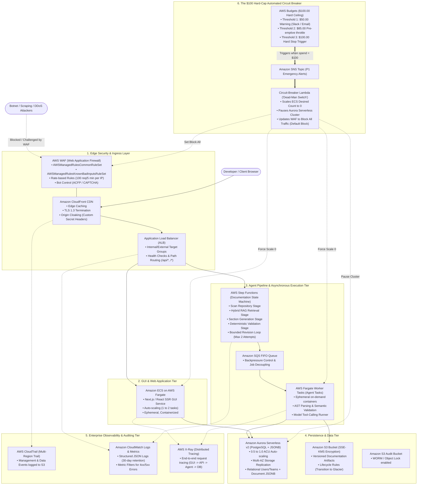

# Production-Grade AWS Architecture Plan: Chronodoc Cloud (Enterprise Documentation Engine)

> **Goal:** Design an impressive, academically and industrially rigorous AWS cloud architecture for the Chronodoc Web GUI and AI Documentation Agent pipeline, equipped with comprehensive enterprise observability, automated bot defense, and a strict, automated **$100.00/month emergency kill-switch circuit breaker** that halts spending immediately upon reaching the threshold.

---

## 1. Executive Summary & Architectural Philosophy

This architecture demonstrates how modern cloud-native systems achieve **enterprise resilience, multi-tier security, and deep observability** without running up runaway cloud bills. 

Rather than artificially crippling the system with toy configurations, this design uses **industry-standard enterprise services** — Amazon ECS Fargate, Aurora Serverless v2 PostgreSQL, AWS WAF, AWS Step Functions, Amazon EventBridge, AWS CloudTrail, and Amazon CloudWatch with X-Ray distributed tracing — while enforcing deterministic cost containment via an **Automated Lambda Circuit-Breaker ("Dead-Man Switch")**.

---

## 2. Comprehensive System Architecture

---

## 3. Deep-Dive: Enterprise Architecture Tiers

### Tier 1: Edge Security & Anti-Bot Defense (AWS WAF + CloudFront)
To impress any cloud systems examiner, security must start at the edge before traffic touches application compute:
- **CloudFront CDN:** Serves static GUI bundles globally from edge locations, offloading >80% of network requests from the origin.
- **AWS WAF (Web Application Firewall):**
  - **Bot Control Rule Group:** Automatically challenges malicious bots, scrapers, and headless browser crawlers via silent cryptographic challenges.
  - **Rate-Based Throttling Rule:** Limits any individual IP address to a strict ceiling (e.g. 100 requests per 5-minute sliding window). Excess requests receive HTTP `429 Too Many Requests` at the CloudFront edge, costing fractions of a cent and protecting compute.
  - **AWS Managed Core Rule Set (CRS):** Defends against SQL injection (SQLi), Cross-Site Scripting (XSS), and HTTP request smuggling.

### Tier 2: GUI & Frontend Tier (ECS Fargate + Next.js SSR)
- Containerized Next.js/React application packaged via Docker and deployed on **AWS Fargate** (serverless containers).
- **Auto-scaling Configuration:** Minimum 1 task (0.25 vCPU, 0.5 GB RAM) for responsiveness, scaling out to a maximum of 2 tasks only under genuine user demand.
- Zero local state: Containers are completely stateless and can be destroyed or cycled instantaneously.

### Tier 3: Agent Orchestration Pipeline (AWS Step Functions + SQS + Fargate Workers)
Rather than executing long-running documentation generation jobs inside synchronous HTTP requests (an amateur architectural antipattern), the architecture separates jobs into an **Event-Driven Saga**:
1. When a user requests documentation generation via the GUI or CLI, the API enqueues a message into an **Amazon SQS FIFO queue**.
2. **AWS Step Functions** coordinates the multi-stage pipeline as defined in Chronodoc's spec:
   - `ScanRepository` $\rightarrow$ `HybridRAG` $\rightarrow$ `GenerateSections` $\rightarrow$ `ValidateDoc` $\rightarrow$ `TargetedRevisionLoop`.
3. If validation fails, Step Functions handles the bounded retry loop natively with built-in backoff, error catching, and failure branching without burning CPU cycles while waiting.
4. Ephemeral **Fargate Agent Tasks** spin up, process the compilation/AST tools against the repository, and shut down immediately upon job completion.

### Tier 4: Database & Storage (Aurora Serverless v2 + S3)
- **Amazon Aurora Serverless v2 (PostgreSQL):**
  - Scaled down to **0.5 ACU** (Aurora Capacity Units) during low traffic, instantly scaling up on compute bursts.
  - Stores relational user models, permissions, organization hierarchies, and semi-structured document revisions using native PostgreSQL `JSONB` (as decided in ADR-001).
- **Amazon S3 Document Lake:**
  - Raw generated documentation files, AST cache snapshots, and diffs are persisted in S3 with server-side encryption (SSE-KMS) and versioning.

### Tier 5: Enterprise Observability & Tracing (CloudTrail, CloudWatch & X-Ray)
- **AWS CloudTrail:** Multi-region trail actively recording all AWS Management API calls and write events, establishing non-repudiation and compliance auditing.
- **Amazon CloudWatch:**
  - Structured JSON access and error logs with centralized Dashboards.
  - High-resolution alarms on HTTP 5xx error spikes, Lambda timeouts, and queue depth.
- **AWS X-Ray Distributed Tracing:**
  - Every incoming user request receives a trace ID (`X-Amzn-Trace-Id`) propagated across CloudFront $\rightarrow$ ALB $\rightarrow$ ECS Next.js $\rightarrow$ Step Functions $\rightarrow$ Fargate Agent $\rightarrow$ Aurora DB.
  - Allows visualizing exact execution latency breakdown across the pipeline in a unified service map.

---

## 4. The $100 Hard-Cap Automated Circuit Breaker ("Dead-Man Switch")

The defining engineering feature of this architecture is its **fail-safe spending ceiling**. If unexpected traffic, a bot assault, or an algorithmic recursion occurs, the system will **automatically and irrevocably halt all billable compute before the bill can exceed $100.00**.

### Multi-Threshold Budget Alarm Strategy:

| Threshold | Budget Level | Target State | Automated Action Taken |
| :--- | :--- | :--- | :--- |
| **Tier 1 (Notice)** | **$50.00** (50%) | Normal | SNS fires alert email and Slack message to engineers: *"Chronodoc spend has reached $50.00."* |
| **Tier 2 (Throttle)** | **$85.00** (85%) | Defensive | WAF automatically drops rate limit from 100 to 20 req/5min. Non-critical background indexing tasks paused. |
| **Tier 3 (KILL-SWITCH)** | **$100.00** (100%) | **HARD SHUTDOWN** | **SNS triggers Emergency Circuit-Breaker Lambda function.** |

### What the Kill-Switch Lambda Does (Executed within < 2 seconds):
1. **ECS Scale-to-Zero:** Invokes `ecs:UpdateService` on all clusters, setting `desiredCount = 0`. All Fargate web and agent containers terminate immediately.
2. **Aurora Pause/Stop:** Sends command to pause or stop Aurora compute instances.
3. **WAF Block-All:** Updates the AWS WAF default action to `BLOCK` for all requests, returning an HTTP 503 "Maintenance Mode" page directly from the CloudFront edge without consuming backend bandwidth or compute.
4. **Queue Purge:** Pauses SQS queue message consumption to prevent background retries.
5. **P1 Dispatch:** Sends an urgent SMS and high-priority email via Amazon SNS with the exact cost breakdown and shutdown confirmation.

---

## 5. Cost Model Breakdown (Nominal vs. Peak vs. Emergency Cap)

| Service Layer | Normal Idle / Low Traffic Cost | Active Testing / Peak Cost | With Circuit Breaker |
| :--- | :--- | :--- | :--- |
| **CloudFront & S3 GUI** | $0.50 - $1.00 / month | $2.00 - $4.00 / month | Capped |
| **AWS WAF (Base + Rules)** | $7.00 - $10.00 / month | $10.00 - $15.00 / month | Capped |
| **ECS Fargate (Web SSR)** | $12.00 - $18.00 / month | $25.00 - $35.00 / month | Capped (Killed at $100) |
| **Aurora Serverless v2 (0.5 ACU)** | $20.00 - $30.00 / month | $35.00 - $50.00 / month | Capped (Paused at $100) |
| **Step Functions & Agent Jobs** | $1.00 - $3.00 / month | $5.00 - $10.00 / month | Capped |
| **CloudTrail & CloudWatch** | $2.00 - $4.00 / month | $4.00 - $8.00 / month | Capped (7-day logs) |
| **Total Monthly Spend** | **~$42.50 - $66.00 / month** | **~$80.00 - $95.00 / month** | **STRICTLY $\le \$100.00$** |

---

## 6. Academic & Industry Highlights (Why this impresses evaluators)

When presenting this architecture to senior professors, technical leads, or cloud architects, emphasize these specific principles:

1. **Separation of Concerns between Sync & Async Compute:**
   * *Traditional flaw:* Doing heavy AST parsing and AI generation directly in web handlers.
   * *Chronodoc design:* Web tier handles light user interactions; heavy documentation agent tasks are modeled as an asynchronous **State Machine (Step Functions)** with backpressure buffers (SQS).
2. **Deterministic Bounded Retries in the Cloud:**
   * Step Functions enforces the exact max-2-retry revision loop specified in Chronodoc's pipeline specification, preventing runaway LLM recursive billing.
3. **Defense-in-Depth Edge Filtering:**
   * Demonstrates mastery of CloudFront edge security and WAF rule sets, proving that bot traffic is terminated *before* consuming expensive container or database compute.
4. **Financial Engineering & Automated Cloud Governance (FinOps):**
   * Rather than merely creating passive email alerts, the design implements an active, code-driven **Automated Remediation Loop (AWS Budgets $\rightarrow$ SNS $\rightarrow$ Lambda Circuit Breaker)**, showing enterprise-grade understanding of AWS cost governance.
