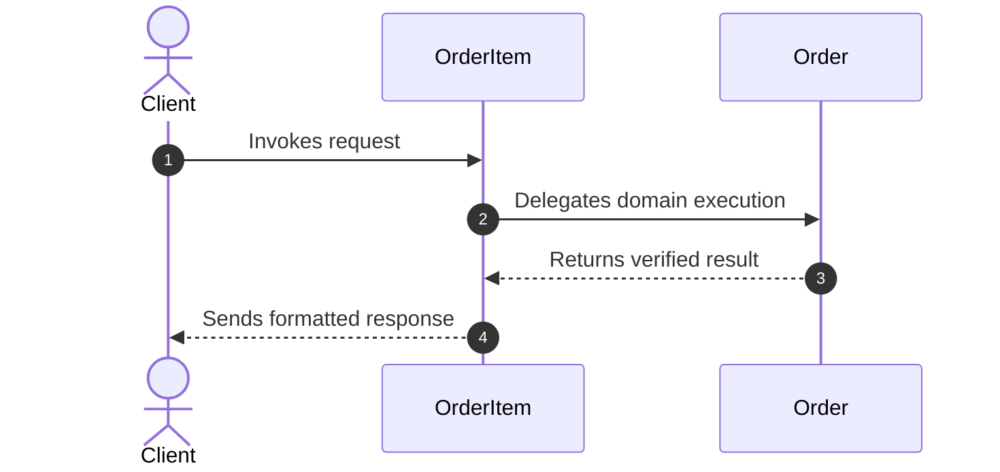

# Data Flow & Workflows

## Primary Execution Workflow

Sequence diagram illustrating the end-to-end request and operation lifecycle:

## Error Handling & Edge Cases

1. Validation failures halt processing and return early actionable feedback.
2. Unexpected runtime exceptions are caught and sanitized before boundary exit.
