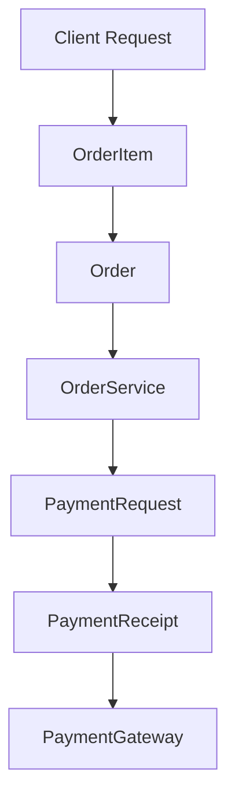

# Architecture Overview

## System Topology

High-level topology illustrating verified component communication:

## Major Components

Key architectural building blocks verified from source code inspection:

- **`OrderItem`** (`interface`): Exported from `src\orderService.ts`
- **`Order`** (`interface`): Exported from `src\orderService.ts`
- **`OrderService`** (`class`): Exported from `src\orderService.ts`
- **`PaymentRequest`** (`interface`): Exported from `src\paymentGateway.ts`
- **`PaymentReceipt`** (`interface`): Exported from `src\paymentGateway.ts`
- **`PaymentGateway`** (`class`): Exported from `src\paymentGateway.ts`

## Architectural Constraints & Principles

- **Single Responsibility**: Modules maintain explicit boundaries with decoupled dependencies.
- **Deterministic Execution**: Runtime behaviors verify state without ungrounded side-effects.
